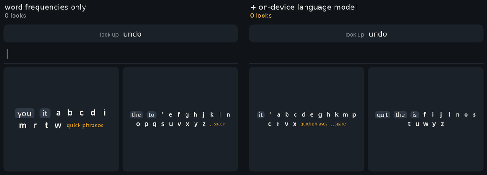
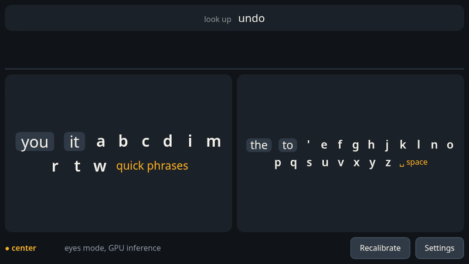
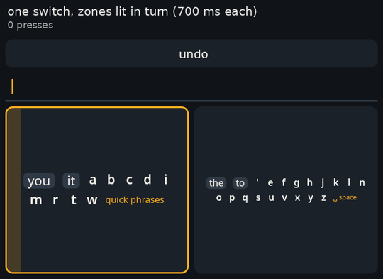

# lookspeak

Type and speak with your eyes using the webcam you already have, or with a single switch or a long blink. It runs in the browser, works offline after the first visit, and no video leaves your device. Boards for English, Turkish, Spanish, German, French, Portuguese and Italian.

**Try it: https://tahakocp.github.io/lookspeak/** (Chrome, Edge or Firefox on a laptop or desktop with a webcam)



<sub>Same sentence, one selection per frame, arrow keys standing in for looks. Left: word frequencies only. Right: with the on-device model, which offers "coffee" and "tea" after "a cup of".</sub>

New in 0.3:

- An optional language model (SmolLM2, 135M parameters) runs on your own computer and reorders the board around the sentence you are typing. On the standard 500-phrase test set it cuts the looks needed per character from 2.48 to 1.79, 28% fewer: about 5.2 words per minute instead of 3.7. WebGPU when the GPU is fast enough, WebAssembly on the CPU otherwise.
- One-switch mode for people who cannot hold a gaze: the zones light up in turn and one key, one click or a long blink picks.
- Six more board languages, each measured on 500 sentences.
- Carer tools: a profile file that carries the phrases, settings and remembered words to another computer, and a chime in the quick phrases to call someone.

All speed numbers come from a simulated user, not from real people; details below.

lookspeak is for people who cannot speak or type with their hands, such as people with ALS/MND, cerebral palsy, locked-in syndrome or after a stroke, and for the family and carers who set it up. Speech-generating devices typically cost [around $15,000](https://alsnetwork.org/understanding-als/living-with-als/guides-for-daily-living/als-communication-devices/) and need a speech therapist's evaluation plus insurance authorization before they arrive. lookspeak is not a replacement for a properly fitted device, but it costs nothing and can be running in two minutes while you wait for one.

## How it works

The screen has two halves. Look at the half that holds your next letter or word and hold your gaze for 0.8 seconds. That half splits again, until one item is left. Look up to go back one step or undo.



<sub>Recorded in headless Chrome at 2x speed. The "user" is a test photo with digitally moved irises (see [How it is tested](#how-it-is-tested)), hidden from the recording.</sub>

Webcam eye tracking is too coarse to aim at small keys, so lookspeak only asks for three clear movements: left, right and up. The halves are not alphabetical. They are built as a Huffman tree over what you are likely to type next, using English word frequencies, so common letters and whole words take one or two looks while a rare letter takes six or seven.

| board (MacKenzie phrase set, 500 phrases, 14,809 characters) | looks per character | words / min at 0.8 s dwell |
|---|---|---|
| alphabetical halves, no prediction | 5.14 | 1.8 |
| frequency-weighted halves | 2.61 | 3.5 |
| frequency-weighted + 4 word predictions (default) | **2.48** | 3.7 |
| default, user makes 5% wrong looks | 3.24 | 2.8 |
| default, user makes 10% wrong looks | 4.74 | 1.9 |
| default, same phrases again with memory of the first pass | **1.77** | 5.2 |

Simulated user who always takes the shortest route; words/min assumes 0.8 s dwell plus 0.5 s to look back to the center and read the next screen. Reproduce with `npm run bench`. The last row is the same 500 phrases typed a second time, after the board has remembered the first pass on the device; a first visit is still 2.48. A short personal set of four sentences (including a name the dictionary does not have) went from 2.65 looks per character on the first pass to 0.67 on the fifth. For comparison, dwell-time eye typing with a dedicated tracker and an on-screen keyboard is usually reported at about 5-10 words per minute ([Majaranta & Räihä, 2002](https://doi.org/10.1145/507072.507076)). The numbers above are not from real users.

## Context-aware predictions (optional)

Turn on "Context-aware predictions" in Settings. The page downloads [SmolLM2-135M](https://huggingface.co/onnx-community/SmolLM2-135M-ONNX) once (182 MB, or 117 MB on GPUs with 16-bit float support) and keeps it in the browser cache, so it also works offline afterwards. It runs in a background worker; what you type never leaves the device.

How it is wired: after each finished word, the model reads the sentence so far (and the last two sentences you spoke) and gives a probability for every next token. Each of the 20,000 dictionary words gets the probability of its first token, shared with other words that start with the same token in proportion to how common they are. That is one model call per word, not per letter, so it stays cheap. The board then mixes 80% model with 20% plain word frequency (the mix was chosen on phrases 1-100 only) and builds the halves from that. If the answer arrives after you have started a selection, the halves stay put until you are back at the top.

| simulated user, MacKenzie phrase set | looks / char, word list | with the model | fewer looks | words / min |
|---|---|---|---|---|
| all 500 phrases | 2.48 | **1.79** | 28% | 3.7 -> 5.2 |
| phrases 101-500 (not used for tuning) | 2.47 | 1.78 | 28% | 3.7 -> 5.2 |
| model also sees the previous phrase | 2.48 | 1.79 | 28% | 3.7 -> 5.2 |
| 5% wrong looks | 3.24 | 2.30 | 29% | 2.8 -> 4.0 |
| 10% wrong looks | 4.74 | 3.39 | 29% | 1.9 -> 2.7 |
| second pass with on-device memory | 1.77 | 1.59 | 10% | 5.2 -> 5.8 |
| one switch, scan steps / char (1 s steps) | 3.57 | 2.57 | 28% | 3.4 -> 4.7 |

Reproduce with `npm run bench:lm` (a few minutes on 8 CPU cores, 9 ms per model call in Node; the CI job prints the same numbers). In headless Chrome on the same machine, one prediction takes about 270 ms on a single WebAssembly thread, well inside one look (0.8 s dwell + 0.5 s). The browser test types "i would like a cup of coffee" in 39-40 selections with the model and 68 without (it depends on whether the model has answered before the next key).

WebGPU: if the GPU answers slower than 1 s per word after warm-up (for example software rendering without a GPU driver, where it took 3.6 s) or fails, the worker switches to WebAssembly by itself. I have not been able to try it on a real GPU yet.

## One switch or a long blink

Some people cannot hold their eyes on one side for most of a second, or the camera cannot see their eyes well, but they can press one button, move a finger, or close their eyes on purpose. In "One switch or long blinks" mode the left half, the right half and the top bar light up in turn. Press Space, Enter, click anywhere on the board, or (with the setting on) close your eyes for about half a second when the one you want is lit. The first zone stays lit half a second longer after each pick. Scan speed is in Settings (0.5 to 3 s per step).



<sub>Real time, 0.7 s per step, Space key pressed by the test script when the right zone is lit.</sub>

Picking the first half costs one step and the second half two, so the board puts the more likely half first. I tried building the tree for those costs directly (about 62% of the probability in the first half, from p + p² = 1), but the plain Huffman tree with the heavier half first already lands within 1-3% of the theoretical minimum for these costs, so I kept it; a unit test holds it to that.

| one switch, 500 MacKenzie phrases, 1 s per step | scan steps / char | words / min |
|---|---|---|
| row-column grid, most frequent letters nearest the start, no prediction | 4.47 | 2.7 |
| lookspeak board + 4 word predictions | 3.57 | 3.4 |
| same, 5% wrong picks | 4.90 | 2.5 |
| lookspeak + language model | **2.57** | 4.7 |

The row-column grid is the usual single-switch layout and is given its best case here (perfect timing, optimal letter placement); reproduce with `npm run bench`. Long blinks are detected from MediaPipe's eye-blink scores: eyes closed for 0.5 to 2.5 s counts, ordinary blinks (under about 0.4 s) and longer rests do not. That logic has unit tests on synthetic streams; it has not been tried on a real person yet.

## Languages

Pick the board language on the start screen or in Settings. Each language has its own letters (ç ğ ı ö ş ü for Turkish, ñ and accents for Spanish, and so on), a 20,000-word frequency list from the same subtitle corpus as English, and quick phrases in that language. Speech uses a voice for that language if your system has one. Word lists for languages other than English are downloaded only when you pick them (about 270 KB) and are cached for offline use.

| 500 Tatoeba sentences per language | letters | alphabetical halves | lookspeak + 4 words | words / min |
|---|---|---|---|---|
| English | 27 | 5.11 | 2.67 | 3.5 |
| Türkçe | 29 | 5.18 | 2.77 | 3.3 |
| Español | 33 | 5.41 | 2.53 | 3.6 |
| Deutsch | 30 | 5.23 | 2.43 | 3.8 |
| Français | 40 | 5.70 | 2.85 | 3.2 |
| Português | 38 | 5.60 | 2.49 | 3.7 |
| Italiano | 33 | 5.40 | 2.66 | 3.5 |

Looks per character, same simulated user. Reproduce with `npm run bench:lang` (downloads the Tatoeba sentence lists, about 70 MB). Tatoeba sentences are a bit harder than the MacKenzie set (English 2.67 here vs 2.48). Turkish comes out slowest, probably because it is agglutinative and a 20,000-word list covers fewer of the word forms people actually use. The language model is English only: SmolLM2 was trained almost entirely on English, and a multilingual model of similar size would need its own measurements first. The quick phrases were written by me and have not been checked by native speakers of every language yet; corrections are welcome.

## For carers

- **Profile file**: Settings, "Save profile to a file" writes the settings, quick phrases and remembered words to a JSON file. "Load a profile" on another computer adds those words to what it already knows and applies the settings. Calibration and the chosen voice stay with each computer. The file holds what the person has said, so treat it as private.
- **Chime**: the quick phrase list has "chime: call someone", three rising beeps for getting attention from another room. It is not an alarm system.
- **Quick phrases** can be edited in Settings, one per line, in any language.

## What is different from existing tools

| project | input | prediction | runs on |
|---|---|---|---|
| [Look to Speak](https://experiments.withgoogle.com/looktospeak) (Google) | look left/right, same two-halves idea | none: you pick from your own phrase list, no spelling | Android app |
| [OptiKey](https://github.com/OptiKey/OptiKey) | gaze cursor over a full keyboard, built for dedicated eye trackers (webcam also supported) | word completion, optional [Presage](https://github.com/OptiKey/OptiKey/wiki/Next-word-prediction) n-gram engine | Windows |
| [Dasher](https://dasher.at/) | continuous steering into zooming letter boxes | character-level PPM model | desktop apps; v6 with more platforms in beta |
| [Cboard](https://github.com/cboard-org/cboard) | touch or switch on symbol tiles | symbol boards rather than spelling | browser |
| [SpeakFaster](https://www.nature.com/articles/s41467-024-53873-3) (Google research, 2024) | Tobii eye tracker, type initials | fine-tuned large language models expand abbreviations; 29-60% faster for two ALS users | research system |
| [Project Iris](https://devpost.com/software/project-iris-edge-ai-aac-platform) (hackathon project) | webcam gaze cursor over a word grid | Llama 3.2 1B through WebLLM, needs WebGPU and about 700 MB of GPU memory | browser |
| **lookspeak** | webcam, three movements only (left, right, up); one switch or a long blink; keys | 135M model reweights a binary letter-and-word tree; corpus frequencies when the model is off; 7 board languages | browser, WebGPU or CPU |

The new part is the combination: a language model that only has to decide how to split the screen in two, so it works with the coarse gaze a cheap webcam gives, with one switch, and on a computer without a usable GPU, with every speed number measured on public phrase sets by scripts you can rerun. SpeakFaster's numbers come from real users with a dedicated tracker; mine are from a simulation, so they are not directly comparable.

Also on the board:

- **Quick phrases**: on an empty line, one item opens a list of 12 phrases ("yes", "no", "I am in pain", "please call the nurse"...) that are spoken as soon as they are picked. Edit the list in Settings. Phrases you pick often move towards the top.
- **Memory**: words you have spoken stay on this device, so names the dictionary does not have and the word you usually say next are offered sooner. Forget them in Settings.
- **Head mode** for people whose eye movement is limited but who can turn their head a little.
- **Keys or two switches**: left/right/up arrows, `1`/`2`, or a click on a half. Most USB accessibility switches can be set to send these keys. With only one switch, use one-switch mode.
- **Speech** with any voice installed on your system (Settings).

## Setup

1. Open the [demo page](https://tahakocp.github.io/lookspeak/) and allow the camera.
2. Pick "Use my eyes". Keep your head still and follow the dot: center, left, center, right, center, top, center (about 17 seconds).
3. Type. Recalibrate whenever the light changes or the laptop moves.

Tips from testing the classifier: sit about an arm's length from the camera, face the light rather than having a window behind you, and raise the dwell time (Settings) if letters get picked while reading. The footer shows which direction is currently detected.

### Offline or self-hosted

After the first visit, the page, the 3.7 MB face model and the word list are cached, and it opens without a network. To run it on a machine that is never online, download the `-web.zip` file from the [latest release](https://github.com/tahakocp/lookspeak/releases/latest), unzip it and serve the folder on localhost (browsers only allow the camera on `https://` or `localhost`):

```sh
cd lookspeak-v0.3.0-web && python3 -m http.server 8080   # then open http://localhost:8080
```

### Build from source

```sh
git clone https://github.com/tahakocp/lookspeak && cd lookspeak
npm ci && npm run build && npm run serve
```

## How it is tested

| what | how | result |
|---|---|---|
| board, prediction, memory, undo, quick phrases, chime, model-to-word mapping, scanning, blink switch, word lists of all 7 languages, profile files | `npm test`, 59 unit tests in Node | pass |
| language model in the browser | `npm run e2e:lm`: headless Chrome, real model in the worker, keys mode | loads, offers "coffee, tea" after "i would like a cup of" (without it: "you, the, to, it"), 39-40 vs 68 selections for the sentence, loads again with the network off; with software WebGPU it falls back to WebAssembly |
| one-switch mode, languages, carer tools | `npm run e2e` (scan.mjs, carer.mjs): headless Chrome | zones cycle left, right, up; "hi " typed with 13 presses of Space; a click is the same switch; Turkish board shows ı and ş; a profile saved in one browser profile changes the board in a fresh one; chime fires without typing |
| direction classifier and dwell timing | synthetic noisy feature streams | >97% correct per frame, blinks under 250 ms ignored, one selection per look |
| whole app with the real model | `npm run e2e`: headless Chrome, MediaPipe Face Landmarker, webcam replaced by test photos | calibration accepted, a letter and an undo typed by gaze, matches the keyboard path, a 350 ms glance does not fire; same with the CPU throttled 6x |
| typing speed | `npm run bench`, `npm run bench:lm`, `npm run bench:lang` | tables above |
| face tracking speed | e2e runs in headless Chrome, no real GPU | 13-16 frames/s on an 8-core VM, 4-8.5 on GitHub Actions runners (shared CPUs; typing still works at 4) |
| offline | live Pages site loaded once, then Chrome set offline and reloaded | model, word list and calibration load from cache; board works |

The e2e photos are a public-domain NASA portrait with the irises cut out and moved by 0.9 iris radii ([e2e/make_fixtures.py](e2e/make_fixtures.py)). MediaPipe's gaze blendshapes read them as expected (horizontal score +0.22 straight ahead, +0.80 looking left, -0.53 looking right; vertical +0.06 to +0.23 looking up), which lets the test drive the real pipeline without a person.

What has not been tested: real people, real webcams, glasses, low light, nystagmus or other eye conditions, head mode on a moving head (its math has a unit test; the photos cannot turn), long-blink selection on a real face (the test photos cannot close their eyes), and real accessibility switches (they send ordinary key presses, which are tested). Looking up is the weakest direction in the photos and will likely be the weakest for some users. If you try it, please [open an "I tried it" issue](https://github.com/tahakocp/lookspeak/issues/new?template=tried-it.md), whether it worked or not.

## Privacy

Video frames go into the MediaPipe model inside the page and nothing else. There is no server, analytics or account. If you turn on context-aware predictions, the model files are downloaded once from huggingface.co; your text is only ever given to the copy running in your browser. Settings, calibration and the words you have spoken live in your browser's local storage. You can forget the remembered words in Settings.

## Limitations

- The interface text is English in every board language; only the board, the phrases and the voice change. The language model is English only.
- French and Italian elisions (`l'`, `qu'`) are their own words on the board; speech joins them back (`l'homme`), the text on screen keeps the space.
- The model is a 117-182 MB download and needs roughly that much free memory. Speed and memory have not been checked on low-end laptops, phones or real GPUs.
- On a first visit the board only knows the public word list. Memory helps after you have spoken a few sentences, and only in that browser.
- Speech quality depends on the voices your OS provides; some browsers need a network for their best voices.
- Not a medical device. Do not rely on it as the only way to call for help.

## Credits

Language model: [SmolLM2-135M](https://huggingface.co/HuggingFaceTB/SmolLM2-135M) by Hugging Face (Apache-2.0), run with [Transformers.js](https://github.com/huggingface/transformers.js) and ONNX Runtime Web. Face tracking: [MediaPipe Face Landmarker](https://ai.google.dev/edge/mediapipe/solutions/vision/face_landmarker) (Apache-2.0). Word frequencies: [hermitdave/FrequencyWords](https://github.com/hermitdave/FrequencyWords), from OpenSubtitles 2018 (CC BY-SA 4.0, see [data/README.md](data/README.md)). Benchmark phrases: MacKenzie & Soukoreff, "Phrase sets for evaluating text entry techniques", CHI 2003, and sentences from [Tatoeba](https://tatoeba.org) (CC BY 2.0 FR), both downloaded at bench time. The two-halves interaction follows Google's [Look to Speak](https://experiments.withgoogle.com/looktospeak) Android app; lookspeak is unrelated to Google.

The tests and numbers above are from real runs.

## License

MIT for the code. The word lists in `data/` are CC BY-SA 4.0.
